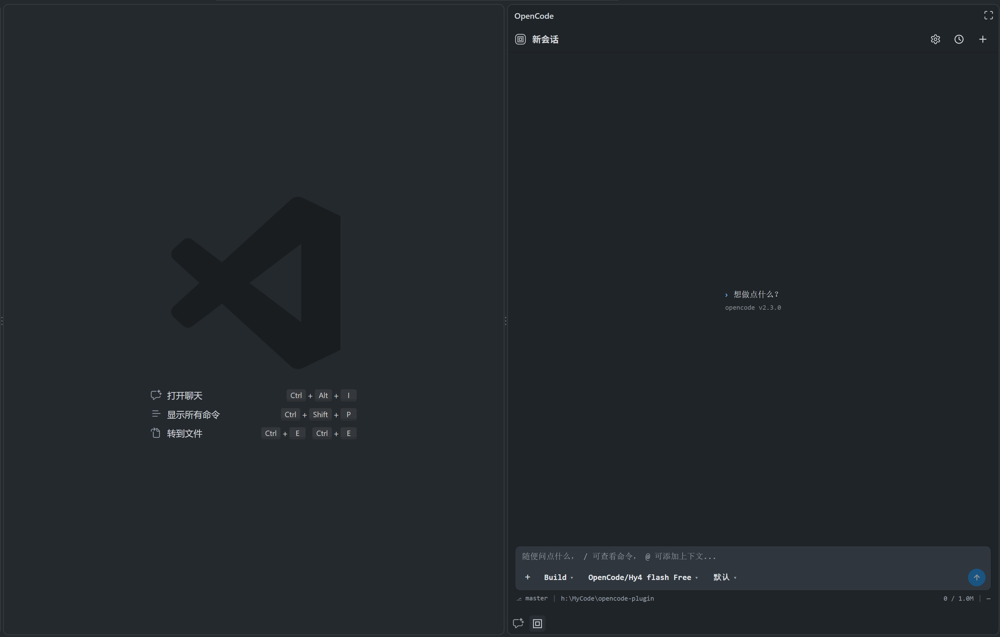

# OpenCode for VS Code

English | [简体中文](README.zh-CN.md)

A [VS Code](https://code.visualstudio.com) extension that puts a full [opencode](https://opencode.ai) v2 chat into your editor �streaming replies, native diffs, session management and permission prompts, reusing the login you already have (including **OpenCode Go subscriptions**).

> Community integration, not an official opencode product.



**One panel, anywhere.** The chat opens in the secondary sidebar (assistant view) or as an editor tab �drag it wherever you work.

## Features

- **Chat panel** (secondary sidebar, movable anywhere) with streaming replies, markdown, collapsible thinking and tool cards.
- **Sessions tree** grouped by date with open / rename / delete / fork / export.
- **Image attachments** �paste or drag up to 6 images per message.
- **Rewind** �revert a session to just before any message (file changes included).
- **Native diffs** �changes open in VS Code's diff editor; keep or revert per file.
- **Permission cards** �Allow once / Always allow / Deny, powered by opencode's permission API.
- **Model & mode pickers** �every provider configured in opencode (including `opencode-go/*` subscription models), reasoning-effort variants, and the native agents (build / plan / custom). `Shift+Tab` cycles modes.
- **Context** �`@` to fuzzy-attach files, `+` for a multi-file picker, auto-attach of the active editor selection.
- **Plan handoff** �finish exploring in plan mode, then one click switches to build and executes.
- **Version guard** �warns (non-blocking) if the connected server's major version is outside the tested v2 range.
- **Zero account handling** �the extension spawns a private `opencode serve` per window (random port + random password, killed with the window) or connects to an existing server; auth stays in your opencode CLI login.

## Requirements

- [opencode CLI](https://opencode.ai/docs) **v2.x** installed and logged in (`opencode auth login`). On Windows without a CLI in `PATH`, the extension falls back to the CLI bundled inside the OpenCode desktop app. An opencode **v1** server is detected and rejected with upgrade guidance (`opencode upgrade`).
- VS Code 1.106+.

## Getting started

1. Install the VSIX from `dist/` (see below) or press **F5** in this repo.
2. Open a workspace folder. The extension starts an opencode server for it.
3. Use **Ctrl/Cmd+Shift+'** or the status bar item to open the chat.

## Packaging

```bash
npm run release      # typecheck + lint + tests + compile + VSIX
```

The artifact lands at `dist/opencode-panel-<version>.vsix`. Install it with:

```bash
code --install-extension dist/opencode-panel-<version>.vsix
```

## Settings

| Setting | Default | Description |
| --- | --- | --- |
| `opencode.path` | `""` | Override the opencode binary path (auto-detected otherwise). |
| `opencode.serverUrl` | `""` | Connect to an already running opencode v2 server instead of spawning one. |
| `opencode.context.autoAttachSelection` | `true` | Attach the active editor's selection as context. |
| `opencode.context.maxSelectionLength` | `2000` | Max characters of a selection to attach. |
| `opencode.notifications.turnComplete` | `true` | Notify when a turn finishes. |
| `opencode.notifications.permissionRequest` | `true` | Notify when the agent asks for permission. |
| `opencode.notifications.errors` | `false` | Notify when the agent or the server reports an error. |
| `opencode.diffList.maxVisibleRows` | `5` | Rows the expanded changed-files list shows before it scrolls. |

The gear button in the chat header opens a settings panel. It edits these
settings together with the opencode server's own configuration
(`opencode.json`), in one place.

## Keyboard shortcuts

| Keys | Action |
| --- | --- |
| `Ctrl/Cmd+Shift+'` | Focus the chat |
| `Shift+Tab` (in composer) | Cycle agent modes |
| `Enter` / `Shift+Enter` | Send / newline |

## Development

```bash
npm install
npm run compile      # build extension + webview
npm run watch        # rebuild on change
npm run typecheck    # tsc --noEmit
npm run lint         # eslint
npm test             # unit tests (node:test)
npm run release      # full verification pipeline + VSIX into dist/
```

Launch with **F5** (Run �Start Debugging) for a dev host with the extension loaded.

The v2 HTTP API used here was verified against opencode 2.2.7/2.3.0's own OpenAPI document (`GET /openapi.json` on the server); `dev/openapi.json` is kept as a reference snapshot. See `docs/adr/` for architecture decisions and `GLOSSARY.md` for terminology.

## Note: pay-as-you-go vs subscription

opencode's default model may live on the `opencode` pay-as-you-go provider �if that balance is empty, turns fail immediately with 402 "Insufficient balance". Your subscription models live under the `opencode-go` provider; pick an `opencode-go/*` model in the model picker to use your Go plan.

## Roadmap

- Message-level history search
- Four permission presets (auto-accept edits / full access)
- Terminal CLI bridge (`/ide`-style)
- Session import

## License

[MIT](LICENSE)
