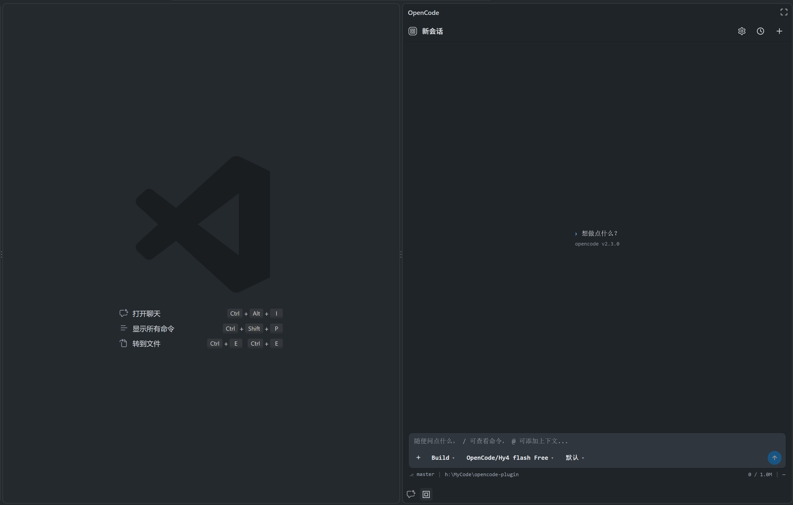

# OpenCode Chat UI

[English](README.md) | 简体中文

一个 [VS Code](https://code.visualstudio.com) 扩展，把完整的 [opencode](https://opencode.ai) v2 聊天体验带进编辑器——流式回复、原生 diff、会话管理、权限审批，直接复用你已有的登录态（包括 **OpenCode Go 订阅**）。

> 社区集成作品，非 opencode 官方产品。



**一个面板，随处可用。** 聊天可以在次级侧栏（助手视图）打开，也可以作为编辑器标签页——拖到你顺手的地方即可。

## 功能

- **聊天面板**（默认在辅助侧边栏，可随意拖动）：流式回复、Markdown 渲染、思考过程与工具调用卡片可折叠展开。
- **会话历史**：只列主会话，按日期分组，支持打开 / 重命名 / 删除 / Fork / 导出；子代理会话不进菜单，在聊天流里观察。
- **完整转写**：长会话向上滚动会补载更早的消息，导出始终包含整段对话。
- **图片附件**：每条消息可粘贴或拖拽最多 6 张图片。
- **Rewind 回滚**：回退到任意消息之前（连同文件修改一起回滚）。
- **原生 Diff**：代码修改直接用 VS Code 的 diff 编辑器查看，支持按文件回滚；已回滚的文件在该会话内不再出现。
- **子代理**：运行中的子代理列在输入框上方并带状态（黄 = 等权限，红 = 失败）；点击行可进入该子代理，左上返回箭头回到上级会话。子代理视图不显示 diff / 排队 / 子代理三条列表。
- **权限卡片**：Allow once / Always allow / Deny，基于 opencode 的权限 API。
- **模型与模式选择器**：opencode 里配置的所有 provider（包括 `opencode-go/*` 订阅模型）、推理力度（effort）变体、原生 agent（build / plan / 自定义 agent），`Shift+Tab` 循环切换。
- **上下文**：`@` 模糊搜索附加文件，`+` 多选文件，自动附加当前编辑器的选区；输入框下方信息条的分支跟随 agent 的会话目录或 worktree。
- **版本守卫**：连接的 server 大版本超出已验证的 v2 范围时给出非阻断警告。
- **零账号处理**——扩展为每个窗口启动一个私有的 `opencode serve`（随机端口 + 随机密码，随窗口关闭而结束），或连接已有 server；认证完全留在你的 opencode CLI 登录态里。

## 环境要求

- 已安装并登录 [opencode CLI](https://opencode.ai/docs) **v2.x**（`opencode auth login`）。Windows 上如果 PATH 里没有 CLI，扩展会自动回退到 OpenCode 桌面应用内置的 CLI。检测到 opencode **v1** server 会明确拒绝并给出升级引导（`opencode upgrade`）。
- VS Code 1.106+。

## 快速开始

1. 安装 `dist/` 下的 VSIX（见下），或在本仓库按 **F5**。
2. 打开一个工作区文件夹，扩展会为它启动 opencode server。
3. **Ctrl/Cmd+Shift+'** 或点击状态栏图标打开聊天。

## 打包

```bash
npm run release      # 类型检查 + lint + 测试 + 编译 + VSIX
```

产物在 `dist/opencode-chat-ui-<version>.vsix`，安装：

```bash
code --install-extension dist/opencode-chat-ui-<version>.vsix
```

## 设置

| 设置项 | 默认值 | 说明 |
| --- | --- | --- |
| `opencode.path` | `""` | 手动指定 opencode 二进制路径（否则自动探测）。 |
| `opencode.serverUrl` | `""` | 连接已运行的 opencode v2 server，而不是每个窗口启动一个。 |
| `opencode.context.autoAttachSelection` | `true` | 发送消息时自动附加当前编辑器的选区。 |
| `opencode.context.maxSelectionLength` | `2000` | 选区附加的最大字符数。 |
| `opencode.notifications.turnComplete` | `true` | 一轮对话结束时通知。 |
| `opencode.notifications.permissionRequest` | `true` | agent 请求权限时通知。 |
| `opencode.notifications.errors` | `false` | agent 或 server 报错时通知。 |
| `opencode.composer.submitKey` | `enter` | 发送按键：`enter` 或 `ctrlEnter`（macOS 为 ⌘Enter）。 |
| `opencode.composer.showContextBar` | `true` | 显示输入框下方的信息条（分支、路径、上下文用量）。 |
| `opencode.diffList.maxVisibleRows` | `5` | 改动文件列表展开时超出多少行后出现滚动条。 |
| `opencode.ui.preferredLocation` | `sidebar` | **OpenCode: Open** 与状态栏按钮的落点：`sidebar` 或 `editor`。 |
| `opencode.startup.autoOpen` | `false` | 打开工作区时自动打开聊天面板。 |

聊天面板标题栏的齿轮按钮会打开设置面板，在同一处编辑上述设置以及 opencode
服务端自己的配置（`opencode.json`）——包括 `experimental.subagent_depth`
（默认 1，禁止子代理再派生子代理的开关）。

## 快捷键

| 按键 | 动作 |
| --- | --- |
| `Ctrl/Cmd+Shift+'` | 聚焦聊天面板 |
| `Shift+Tab`（输入框内） | 循环切换 agent 模式 |
| `Enter` | 光标在末尾时发送；光标在正文中间时确认 `/` 或 `@` 补全（发送键见 `opencode.composer.submitKey`） |
| `Shift+Enter` | 换行 |

## 开发

```bash
npm install
npm run compile      # 构建扩展 + webview
npm run watch        # 监听重编译
npm run typecheck    # tsc --noEmit
npm run lint         # eslint
npm test             # 单元测试（node:test）
npm run release      # 全链验证 + 产出 VSIX 到 dist/
```

在本仓库按 **F5**（运行 → 启动调试）即可启动加载了扩展的开发宿主。

本扩展使用的 v2 HTTP API 已对照 opencode 2.2.7/2.3.0 自带的 OpenAPI 文档（server 上的 `GET /openapi.json`）逐一验证；快照保留在 `dev/openapi.json` 作参考。架构决策见 `docs/adr/`，术语表见 `GLOSSARY.md`。

## 提示：按量通道与订阅

opencode 的默认模型可能落在 `opencode` 按量付费通道——如果该通道余额为 0，对话会立刻报 402 "Insufficient balance"。你的订阅模型在 `opencode-go` provider 下，从模型选择器里选 `opencode-go/*` 即可使用订阅额度。

## 路线图

- 会话内历史搜索
- 四档权限预设（自动接受编辑 / 完全访问）
- 终端 CLI 桥接（`/ide` 风格）
- 会话导入

## 许可

[MIT](LICENSE)
